# AI-Driven API Test Generator — Architecture & Pseudocode (Member M4)

Specialized for:
- **Pool A:** FR-03 (`POST /api/forgot-password`, `POST /api/reset-password`)
- **Pool B:** FR-09 (`POST /api/apply-coupon`)
- **Pool C:** FR-19 (`GET /api/admin/users`, `DELETE /api/admin/users/:id`)

---

## 1. M4 System Architecture Diagram

```mermaid
flowchart TD
    subgraph M4Input ["1. M4 Specification & Input Data"]
        In1["API Specs: FR-03, FR-09, FR-19"]
        In2["Security Policies: SEC-01, SEC-02, SEC-03, SEC-07"]
        In3["Business Rules: 5 Coupon Conditions (C1-C5), OTP Rules, Admin Self-Delete Guard"]
        In4["Student Identity Header (X-Student-Id)"]
    end

    subgraph M4Engine ["2. M4 AI Test Generator Engine"]
        E1["M4 Endpoint Decomposer"]
        E2["Domain Partition & BVA Module (Boundary on min_order_amount, OTP length)"]
        E3["State Transition Generator (OTP flow, Coupon usage increment, User deletion)"]
        E4["Security Mutation Engine (SEC-03 BAC Role Escalation, Plaintext Password, SQLi)"]
        E5["Schema & Contract Verifier (Type checks, Error structures)"]
    end

    subgraph M4AuditFilter ["3. M4 Human-in-the-Loop Audit & Extension"]
        A1["Classification Gate (VALID / INVALID / INCOMPLETE)"]
        A2["Manual Repair of Flawed AI Assertions"]
        A3["Extension Engine: Inject +5 Subtle Missed Edge Cases per API"]
    end

    subgraph M4Execution ["4. Postman & Newman Automation"]
        Ex1["Postman Collection v2.1 Exporter (Embedded Pre-request Scripts)"]
        Ex2["Newman CLI Runner with htmlextra reporter"]
        Ex3["Assertions Evaluator (Tracking Status, Body Schema, Logic Bugs)"]
        Ex4["GitHub Actions CI/CD Pipeline Integration"]
    end

    subgraph M4Artifacts ["5. Evaluation Evidence & Deliverables"]
        R1["HTML Newman Execution Report (with localhost:3000 & X-Student-Id)"]
        R2["Discovered Bugs Matrix (SQLi, SEC-03 BAC, Strict '>' Bug, Formula Bug)"]
        R3["AI Audit Report Log (report/ai_audit.md)"]
        R4["Excel Test Case Spreadsheet (HW06 Deliverable)"]
    end

    M4Input --> M4Engine
    M4Engine --> M4AuditFilter
    M4AuditFilter --> M4Execution
    M4Execution --> M4Artifacts
```



---

## 2. Generator Core Pseudocode (Specialized for Member M4)

```python
"""
Algorithm: AI-Driven API Test Generator for Member M4 (HW06 EShop)
Target APIs:
  - FR-03: POST /api/forgot-password, POST /api/reset-password
  - FR-09: POST /api/apply-coupon
  - FR-19: GET /api/admin/users, DELETE /api/admin/users/:id
"""

class M4APITestGenerator:
    def __init__(self, student_id="M4_STUDENT_ID", base_url="http://localhost:3000"):
        self.student_id = student_id
        self.base_url = base_url
        self.test_suite = []

    def generate_all_m4_suites(self):
        # 1. Pool A: FR-03 (Forgot & Reset Password)
        fr03_suite = self.generate_fr03_password_tests()
        
        # 2. Pool B: FR-09 (Apply Coupon)
        fr09_suite = self.generate_fr09_coupon_tests()
        
        # 3. Pool C: FR-19 (Admin User Management)
        fr19_suite = self.generate_fr19_admin_user_tests()
        
        # Combine and apply human audit & extension rules
        raw_tests = fr03_suite + fr09_suite + fr19_suite
        audited_tests = self.audit_test_suite(raw_tests)
        extended_tests = self.inject_m4_missed_edge_cases(audited_tests)
        
        return self.export_postman_collection(extended_tests)

    def generate_fr03_password_tests(self):
        tests = []
        # Domain Partitions: Email formats
        for email in ["valid@eshop.com", "", "invalid-format", "nonexistent@eshop.com", "' OR 1=1 --"]:
            tests.append({"endpoint": "/api/forgot-password", "payload": {"email": email}, "type": "DP"})
        
        # SEC-07: OTP Length & Entropy verification
        tests.append({"endpoint": "/api/forgot-password", "check": "assert_otp_length_gte_6"})
        
        # State Transitions: Forgot -> Reset -> Login with new password
        tests.append({"sequence": ["forgot-password", "reset-password", "login"], "type": "STATE_TRANSITION"})
        
        # Replay Attack / Invalidation
        tests.append({"sequence": ["reset-password", "reset-password-again-with-same-token"], "type": "SEC_TOKEN_REUSE"})
        return tests

    def generate_fr09_coupon_tests(self):
        tests = []
        # Test 5 Conditions (C1 - C5)
        # Boundary on min_order_amount (Detect strict > bug)
        for amount in [299999, 300000, 300001]: # SAVE10 min is 300,000
            tests.append({"endpoint": "/api/apply-coupon", "code": "SAVE10", "total_amount": amount, "type": "BVA_MIN_AMOUNT"})
        
        # Calculation formula verification (Detect (1 - discount_value) bug)
        tests.append({"endpoint": "/api/apply-coupon", "code": "SAVE10", "total_amount": 500000, "check": "discount_amount == 50000"})
        
        # Expired coupon test (EXPIRED)
        tests.append({"endpoint": "/api/apply-coupon", "code": "EXPIRED", "total_amount": 500000, "expected_status": 400})
        
        # Usage Limit (C5) Transition: Use once -> Use second time -> Exceed max_uses
        tests.append({"sequence": ["apply-first-time", "record-usage", "apply-second-time"], "type": "STATE_COUPON_LIMIT"})
        return tests

    def generate_fr19_admin_user_tests(self):
        tests = []
        # SEC-03: Broken Access Control (RBAC)
        tests.append({"endpoint": "/api/admin/users", "token_role": None, "expected_status": 401})
        tests.append({"endpoint": "/api/admin/users", "token_role": "user", "expected_status": 403}) # Missing role check bug
        tests.append({"endpoint": "/api/admin/users", "token_role": "admin", "expected_status": 200})
        
        # FR-19 Self-Deletion Guard
        tests.append({"endpoint": "/api/admin/users/:my_id", "method": "DELETE", "expected_status": 400})
        
        # Delete another user & verify state transition
        tests.append({"sequence": ["delete-user-id", "verify-user-absent-in-get-users", "attempt-login-deleted-user"], "type": "STATE_USER_LIFECYCLE"})
        return tests

    def export_postman_collection(self, test_cases):
        # Emits collection with pre-request script embedding X-Student-Id
        return {
            "info": {"name": f"M4 EShop API Suite ({self.student_id})"},
            "item": test_cases
        }
```
