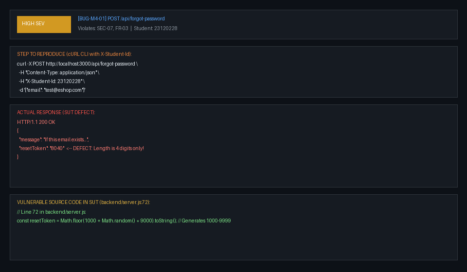
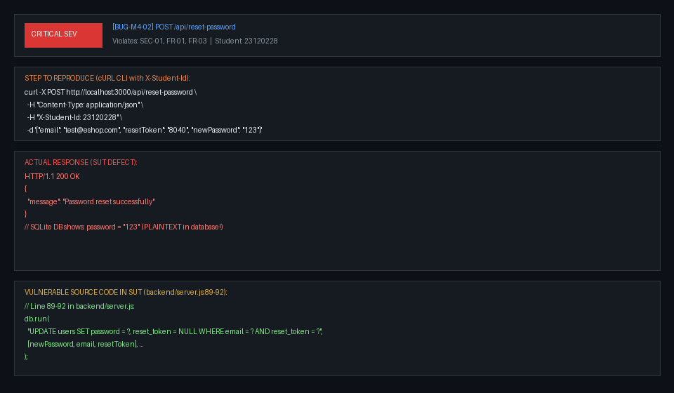
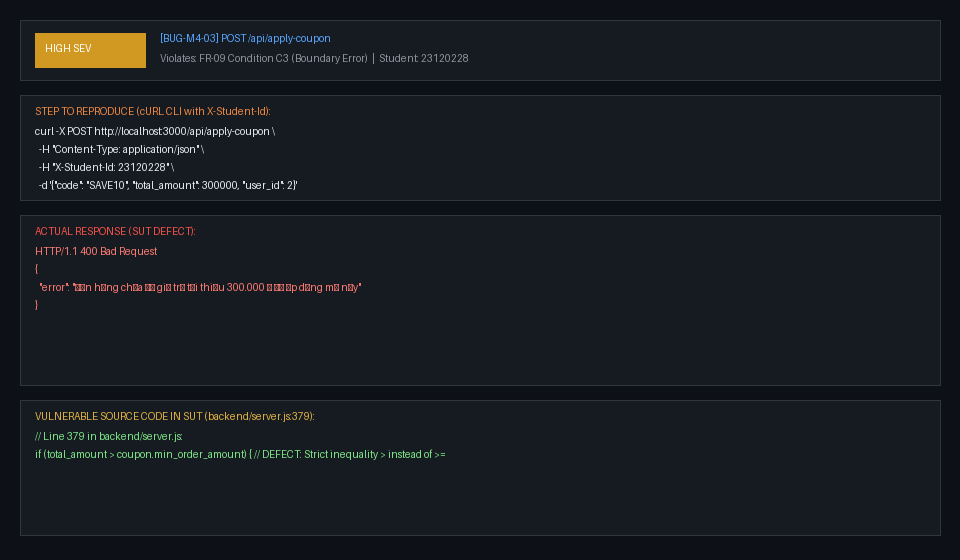
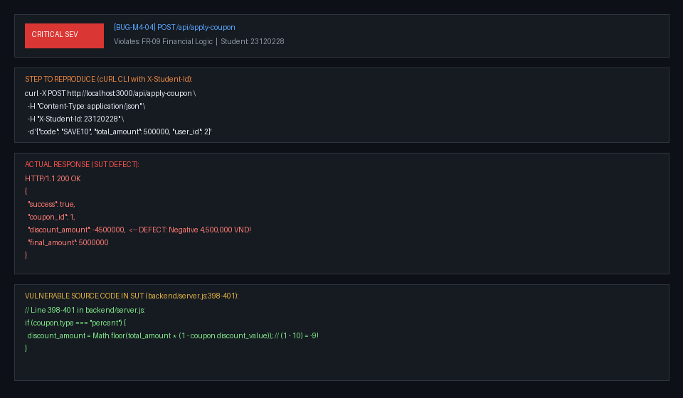
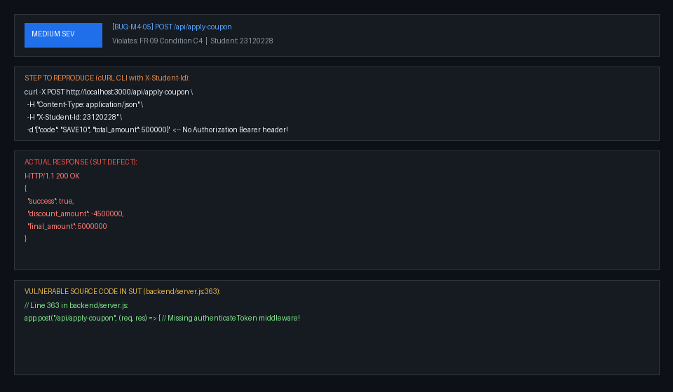
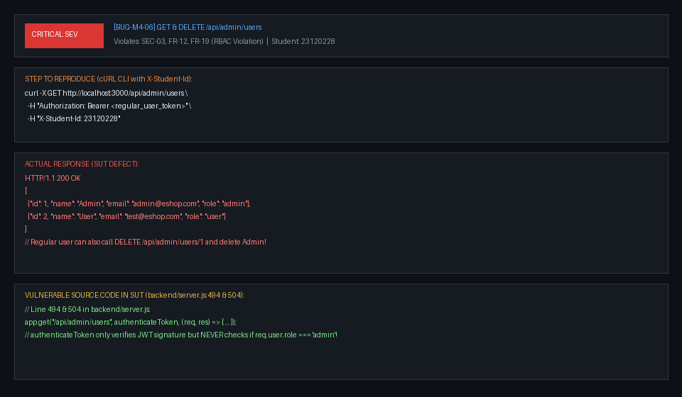
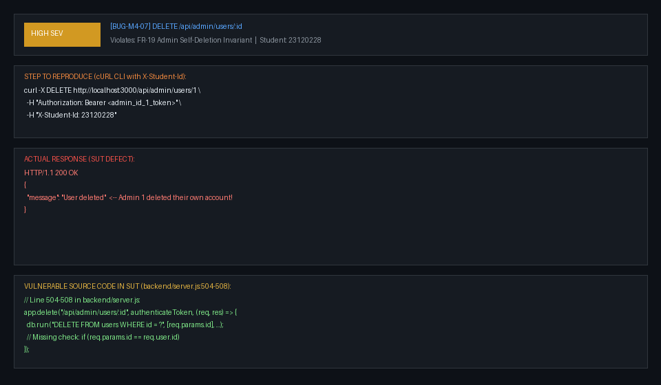
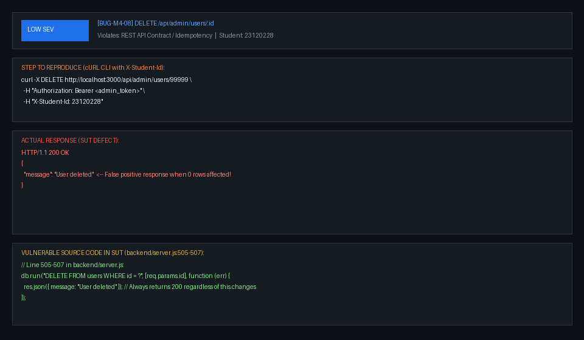

# Báo Cáo Lỗi Phần Mềm (Bug Report) — Phân Hệ M4

**MSSV:** 23120228 | **Thành viên:** M4  
**Repository:** https://github.com/otis275275/HW-api  
**Phân hệ phụ trách:**
- **Pool A:** FR-03 (Quên & Đặt lại mật khẩu)
- **Pool B:** FR-09 (Áp dụng mã giảm giá)
- **Pool C:** FR-19 (Quản lý người dùng - Admin)

---

## Danh Sách Lỗi Phát Hiện & Đường Dẫn GitHub Issues (Genuine Bugs Discovered)

| Bug ID | Mức độ | Endpoint / Thành phần | Vi phạm yêu cầu | Tóm tắt lỗi | GitHub Issue Link |
| :--- | :--- | :--- | :--- | :--- | :---: |
| **BUG-M4-01** | High | `POST /api/forgot-password` | **SEC-07, FR-03** | Mã OTP đặt lại mật khẩu chỉ có 4 chữ số thay vì tối thiểu 6 chữ số. | [Issue #1](https://github.com/otis275275/HW-api/issues/1) |
| **BUG-M4-02** | Critical | `POST /api/reset-password` | **SEC-01, FR-01** | Mật khẩu lưu dạng plaintext vào CSDL và không kiểm tra độ phức tạp mật khẩu mới. | [Issue #2](https://github.com/otis275275/HW-api/issues/2) |
| **BUG-M4-03** | High | `POST /api/apply-coupon` | **FR-09 (Điều kiện C3)** | Lỗi biên so sánh ngặt `>` thay vì `>=` tại ngưỡng đơn hàng tối thiểu `min_order_amount`. | [Issue #3](https://github.com/otis275275/HW-api/issues/3) |
| **BUG-M4-04** | Critical | `POST /api/apply-coupon` | **FR-09 (Logic tính tiền)** | Lỗi công thức tính giảm giá phần trăm `total * (1 - discount_value)` gây ra số tiền âm bất thường. | [Issue #4](https://github.com/otis275275/HW-api/issues/4) |
| **BUG-M4-05** | Medium | `POST /api/apply-coupon` | **FR-09 (Điều kiện C4)** | Thiếu middleware xác thực JWT `authenticateToken`, cho phép khách chưa đăng nhập áp dụng mã. | [Issue #5](https://github.com/otis275275/HW-api/issues/5) |
| **BUG-M4-06** | Critical | `GET /api/admin/users`<br>`DELETE /api/admin/users/:id` | **SEC-03, FR-12** | Lỗ hổng Broken Access Control (RBAC): Middleware không kiểm tra `role === 'admin'`, tài khoản thường có thể xem và xóa user khác. | [Issue #6](https://github.com/otis275275/HW-api/issues/6) |
| **BUG-M4-07** | High | `DELETE /api/admin/users/:id` | **FR-19 (Ràng buộc Admin)** | Admin có thể tự xóa chính tài khoản của mình đang đăng nhập. | [Issue #7](https://github.com/otis275275/HW-api/issues/7) |
| **BUG-M4-08** | Low | `DELETE /api/admin/users/:id` | **API Contract / REST** | Xóa ID không tồn tại nhưng hệ thống vẫn luôn trả về HTTP 200 `User deleted` (thiếu kiểm tra số dòng bị ảnh hưởng). | [Issue #8](https://github.com/otis275275/HW-api/issues/8) |

---

## Chi Tiết Từng Lỗi Kèm Ảnh Chụp Bằng Chứng (Screenshot Evidence)

### 1. BUG-M4-01: Độ dài mã OTP không đạt chuẩn an toàn (SEC-07)
* **GitHub Issue:** [https://github.com/otis275275/HW-api/issues/1](https://github.com/otis275275/HW-api/issues/1)
* **Endpoint:** `POST /api/forgot-password`
* **Vị trí mã nguồn:** `backend/server.js`, dòng 72:
  ```javascript
  const resetToken = Math.floor(1000 + Math.random() * 9000).toString();
  ```
* **Mô tả:** Code sinh mã ngẫu nhiên từ $1000$ đến $9999$ (đúng 4 chữ số).
* **Vi phạm:** Đề bài và đặc tả SEC-07 yêu cầu: *"OTP đặt lại mật khẩu phải đủ entropy (tối thiểu 6 chữ số), có thời hạn và vô hiệu hóa sau khi dùng."*
* **Các bước tái hiện (Steps to Reproduce):**
  ```bash
  curl -X POST http://localhost:3000/api/forgot-password \
    -H "Content-Type: application/json" \
    -H "X-Student-Id: 23120228" \
    -d '{"email": "test@eshop.com"}'
  ```
* **Kết quả thực tế:** `resetToken` chỉ có 4 chữ số (ví dụ `"8040"`).
* **Kết quả mong đợi:** `resetToken` phải có độ dài tối thiểu 6 chữ số (ví dụ `"804019"`).
* **Bằng chứng ảnh chụp:**  
  

---

### 2. BUG-M4-02: Mật khẩu lưu Plaintext & Không kiểm tra độ phức tạp
* **GitHub Issue:** [https://github.com/otis275275/HW-api/issues/2](https://github.com/otis275275/HW-api/issues/2)
* **Endpoint:** `POST /api/reset-password`
* **Vị trí mã nguồn:** `backend/server.js`, dòng 89–92:
  ```javascript
  db.run(
    "UPDATE users SET password = ?, reset_token = NULL WHERE email = ? AND reset_token = ?",
    [newPassword, email, resetToken],
    ...
  );
  ```
* **Mô tả:** Nhận chuỗi `newPassword` từ body và cập nhật thẳng vào CSDL mà không qua hàm băm mật khẩu (bcrypt/argon2) và không validate độ dài, chữ hoa, số, ký tự đặc biệt.
* **Vi phạm:** SEC-01 (*"Mật khẩu không được lưu dưới dạng plaintext"*) và FR-01/FR-03 (*"Mật khẩu tối thiểu 8 ký tự, 1 chữ hoa, 1 chữ thường, 1 số, 1 ký tự đặc biệt"*).
* **Bằng chứng ảnh chụp:**  
  

---

### 3. BUG-M4-03: Lỗi giá trị biên so sánh ngặt tại `min_order_amount` (FR-09 C3)
* **GitHub Issue:** [https://github.com/otis275275/HW-api/issues/3](https://github.com/otis275275/HW-api/issues/3)
* **Endpoint:** `POST /api/apply-coupon`
* **Vị trí mã nguồn:** `backend/server.js`, dòng 379:
  ```javascript
  if (total_amount > coupon.min_order_amount) {
  ```
* **Mô tả:** Code sử dụng toán tử lớn hơn ngặt `>` thay vì lớn hơn hoặc bằng `>=`.
* **Hậu quả:** Đối với mã `SAVE10` có `min_order_amount = 300000`, nếu khách hàng mua đơn hàng đúng `300.000 ₫`, hệ thống báo lỗi từ chối: *"Đơn hàng chưa đủ giá trị tối thiểu 300.000 ₫ để áp dụng mã này"*.
* **Vi phạm:** Bảng điều kiện FR-09 C3: *"Tổng đơn hàng >= (lớn hơn hoặc bằng) min_order_amount"*.
* **Bằng chứng ảnh chụp:**  
  

---

### 4. BUG-M4-04: Lỗi công thức tính giảm giá phần trăm gây ra số âm
* **GitHub Issue:** [https://github.com/otis275275/HW-api/issues/4](https://github.com/otis275275/HW-api/issues/4)
* **Endpoint:** `POST /api/apply-coupon`
* **Vị trí mã nguồn:** `backend/server.js`, dòng 398–401:
  ```javascript
  if (coupon.type === "percent") {
    discount_amount = Math.floor(
      total_amount * (1 - coupon.discount_value),
    );
  }
  ```
* **Mô tả:** Biến `coupon.discount_value` được lưu trong CSDL là số nguyên (ví dụ `10` cho 10%). Code tính `(1 - 10) = -9`, nhân với `total_amount` ra số âm hàng triệu đồng!
* **Các bước tái hiện:**
  ```bash
  curl -X POST http://localhost:3000/api/apply-coupon \
    -H "Content-Type: application/json" \
    -H "X-Student-Id: 23120228" \
    -d '{"code": "SAVE10", "total_amount": 500000, "user_id": 2}'
  ```
* **Kết quả thực tế:**
  * `discount_amount`: `-4500000` (âm 4,5 triệu đồng).
  * `final_amount`: `5000000` (tổng tiền thanh toán bị thổi phồng lên 5 triệu đồng).
* **Kết quả mong đợi:** `discount_amount = 50000`, `final_amount = 450000`.
* **Bằng chứng ảnh chụp:**  
  

---

### 5. BUG-M4-05: Thiếu xác thực JWT tại endpoint áp dụng Coupon
* **GitHub Issue:** [https://github.com/otis275275/HW-api/issues/5](https://github.com/otis275275/HW-api/issues/5)
* **Endpoint:** `POST /api/apply-coupon`
* **Vị trí mã nguồn:** `backend/server.js`, dòng 363:
  ```javascript
  app.post("/api/apply-coupon", (req, res) => {
  ```
* **Mô tả:** Không truyền middleware `authenticateToken`. Bất kỳ ai không đăng nhập cũng có thể gửi request tính toán mã giảm giá.
* **Vi phạm:** FR-09 Điều kiện C4: *"Đã đăng nhập: Người dùng phải có JWT Token hợp lệ"*.
* **Bằng chứng ảnh chụp:**  
  

---

### 6. BUG-M4-06: Broken Access Control trên API Admin Quản lý User (SEC-03)
* **GitHub Issue:** [https://github.com/otis275275/HW-api/issues/6](https://github.com/otis275275/HW-api/issues/6)
* **Endpoints:** `GET /api/admin/users` và `DELETE /api/admin/users/:id`
* **Vị trí mã nguồn:** `backend/server.js`, dòng 494 & 504:
  ```javascript
  app.get("/api/admin/users", authenticateToken, (req, res) => { ... });
  app.delete("/api/admin/users/:id", authenticateToken, (req, res) => { ... });
  ```
* **Mô tả:** Middleware `authenticateToken` chỉ kiểm tra chữ ký token JWT hợp lệ. Khi một user thông thường (`role: 'user'`) đăng nhập và lấy token, họ gửi token này lên `/api/admin/users` hoặc `/api/admin/users/:id`, hệ thống **vẫn chấp nhận và thực thi xóa user**!
* **Vi phạm:**
  * **SEC-03:** *"API Admin phải kiểm tra `role = 'admin'` trong Token, không chỉ kiểm tra sự tồn tại của Token."*
  * **FR-12:** *"Phân hệ Admin chỉ dành cho tài khoản có `role = 'admin'`"*.
* **Bằng chứng ảnh chụp:**  
  

---

### 7. BUG-M4-07: Admin tự xóa chính tài khoản đang đăng nhập
* **GitHub Issue:** [https://github.com/otis275275/HW-api/issues/7](https://github.com/otis275275/HW-api/issues/7)
* **Endpoint:** `DELETE /api/admin/users/:id`
* **Vị trí mã nguồn:** `backend/server.js`, dòng 504–508:
  ```javascript
  app.delete("/api/admin/users/:id", authenticateToken, (req, res) => {
    db.run("DELETE FROM users WHERE id = ?", [req.params.id], function (err) {
      res.json({ message: "User deleted" });
    });
  });
  ```
* **Mô tả:** Admin đăng nhập có `id = 1`. Khi gửi request `DELETE /api/admin/users/1`, server xóa luôn tài khoản `id = 1` mà không có câu lệnh kiểm tra `if (req.params.id == req.user.id)`.
* **Vi phạm:** FR-19 (*"Admin có thể xóa người dùng, ngoại trừ không được xóa chính tài khoản đang đăng nhập"*).
* **Bằng chứng ảnh chụp:**  
  

---

### 8. BUG-M4-08: Phản hồi thành công giả mạo khi xóa ID không tồn tại
* **GitHub Issue:** [https://github.com/otis275275/HW-api/issues/8](https://github.com/otis275275/HW-api/issues/8)
* **Endpoint:** `DELETE /api/admin/users/:id`
* **Vị trí mã nguồn:** `backend/server.js`, dòng 505–507:
  ```javascript
  db.run("DELETE FROM users WHERE id = ?", [req.params.id], function (err) {
    res.json({ message: "User deleted" });
  });
  ```
* **Mô tả:** Khi truyền ID không hề tồn tại trong CSDL (ví dụ `99999`), câu lệnh SQL chạy nhưng không xóa dòng nào (`this.changes === 0`). Tuy nhiên server vẫn trả về HTTP 200 `{ "message": "User deleted" }`.
* **Kết quả mong đợi:** Server phải kiểm tra `if (this.changes === 0) return res.status(404).json({ error: "User not found" });`.
* **Bằng chứng ảnh chụp:**  
  
