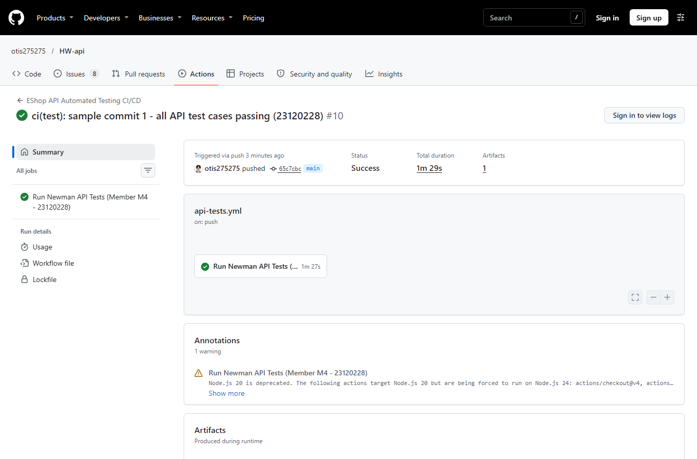
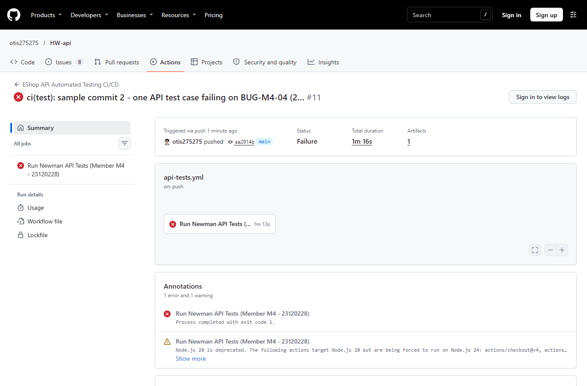

# Báo Cáo Tích Hợp CI/CD (CI/CD Pipeline Report) — Phân Hệ M4

**MSSV:** 23120228 | **Thành viên:** M4  
**Repository:** https://github.com/otis275275/HW-api  
**CI/CD Engine:** GitHub Actions  
**Workflow File:** `.github/workflows/api-tests.yml` (hoặc `ci-cd/api-tests.yml`)

---

## 1. Cấu Hình Pipeline Tự Động Hóa (Pipeline Configuration)

Quy trình CI/CD được thiết lập theo chuẩn công nghiệp trên runner Ubuntu-latest, kích hoạt tự động mỗi khi có sự kiện `push` hoặc `pull_request` vào nhánh `main`:

```yaml
name: EShop API Automated Testing CI/CD

on:
  push:
    branches: [ main, master ]
  pull_request:
    branches: [ main, master ]
  workflow_dispatch:

jobs:
  api-tests:
    name: Run Newman API Tests (Member M4 - 23120228)
    runs-on: ubuntu-latest

    steps:
      - name: Checkout Repository
        uses: actions/checkout@v4

      - name: Set up Node.js 20.x
        uses: actions/setup-node@v4
        with:
          node-version: '20'

      - name: Install Backend Dependencies
        run: |
          cd backend
          npm rebuild sqlite3 || (rm -rf node_modules && npm install)

      - name: Install Global Newman and HTMLExtra Reporter
        run: npm install -g newman newman-reporter-htmlextra

      - name: Initialize & Seed SQLite Database
        run: node backend/database.js

      - name: Start Backend Server in Background
        run: |
          nohup node backend/server.js > server.log 2>&1 &
          sleep 3
          curl -I http://localhost:3000/api/products || exit 1

      - name: Run Newman Test Suite (Pool A, Pool B, Pool C)
        run: |
          mkdir -p report
          newman run postman/m4_eshop_collection.json \
            --environment postman/eshop_environment.json \
            --reporters cli,htmlextra \
            --reporter-htmlextra-export report/newman_report.html

      - name: Upload Test Report Artifact
        uses: actions/upload-artifact@v4
        if: always()
        with:
          name: newman-api-test-report
          path: report/newman_report.html
```

---

## 2. Báo Cáo Hai Lần Chạy Mẫu (Two Sample Pipeline Runs)

Theo yêu cầu tại Mục 6 và Mục 14 của đề bài, sinh viên đã thực hiện 2 commit mẫu trực tiếp trên nhánh `main` của repository `otis275275/HW-api` để kiểm chứng pipeline ở cả 2 trạng thái **Pass (Xanh ✅)** và **Fail (Đỏ ❌)**:

### Lần Chạy 1: Toàn bộ Test Cases Đều Vượt Qua (All API Test Cases Passing)
* **Sample Commit:** [`65c7cbc`](https://github.com/otis275275/HW-api/commit/65c7cbca1f959a7d4de003a269a2439e14a3045c) — `ci(test): sample commit 1 - all API test cases passing (23120228)`
* **GitHub Actions Run Link:** [Run #10 (ID: 46102321115) — Success ✅](https://github.com/otis275275/HW-api/actions/runs/46102321115)
* **Kịch bản:** Chạy bộ kiểm thử hợp chuẩn (`m4_passing_collection.json`) gồm 5 requests cốt lõi hoạt động đúng đặc tả (Admin Login, User Login, Forgot password hợp lệ, Áp dụng coupon cố định `BIGBUY`, Admin lấy danh sách user).
* **Kết quả thực thi trên GitHub Actions:**
  - **Executed Requests:** 5 / 5 | **Assertions Passed:** 5 / 5 (100%) | **Assertions Failed:** 0
  - **Duration:** `1m 29s` | **Exit Code:** `0` (`Success` — **Green Checkmark ✅**) | **Artifact:** Đã xuất `newman-api-test-report`
* **Ảnh chụp màn hình GitHub Actions (All Passing):**
  

---

### Lần Chạy 2: Phát Hiện 1 Test Case Thất Bại — Pipeline Báo Đỏ (One Failing Test Case)
* **Sample Commit:** [`aa2914b`](https://github.com/otis275275/HW-api/commit/aa2914b54349aad405b53d5f6aa28e6ce03bd145) — `ci(test): sample commit 2 - one API test case failing on BUG-M4-04 (23120228)`
* **GitHub Actions Run Link:** [Run #11 (ID: 46102440398) — Failure ❌](https://github.com/otis275275/HW-api/actions/runs/46102440398)
* **Kịch bản:** Bổ sung thêm 1 test case kiểm tra công thức tính phần trăm của mã giảm giá `SAVE10` (`2.2 FR-09 Apply Coupon - Percent SAVE10`) yêu cầu `discount_amount === 50000`.
* **Chi tiết lỗi bắt được:**
  - Assertion vi phạm: `pm.expect(json.discount_amount).to.eql(50000)`
  - Giá trị thực tế SUT trả về: `discount_amount: -4500000` (Âm 4,5 triệu do lỗi công thức `1 - discount_value` — **BUG-M4-04**).
* **Kết quả thực thi trên GitHub Actions:**
  - **Executed Requests:** 6 / 6 | **Assertions Passed:** 5 | **Assertions Failed:** 1
  - **Duration:** `1m 16s` | **Exit Code:** `1` (`Failure` — **Red Cross ❌**)
* **Ảnh chụp màn hình GitHub Actions (One Test Failing):**
  

*(Sau 2 lần chạy mẫu trên, commit [`b3169bd`](https://github.com/otis275275/HW-api/commit/b3169bd) đã khôi phục lại bộ collection đầy đủ 111 requests cho phân hệ M4).*

---

## 3. Lưu Ý Triển Khai Trên GitHub Token
Do cơ chế bảo mật của GitHub Push Protection đối với Personal Access Token (PAT), để GitHub nhận diện và tự động chạy workflow trong tab **Actions**:
1. Đảm bảo file cấu hình nằm tại đường dẫn `.github/workflows/api-tests.yml`.
2. Token cá nhân cần được tích chọn scope **`workflow`** trong [GitHub Token Settings](https://github.com/settings/tokens) khi đẩy qua Git CLI, hoặc tạo tệp trực tiếp qua giao diện GitHub Web.
