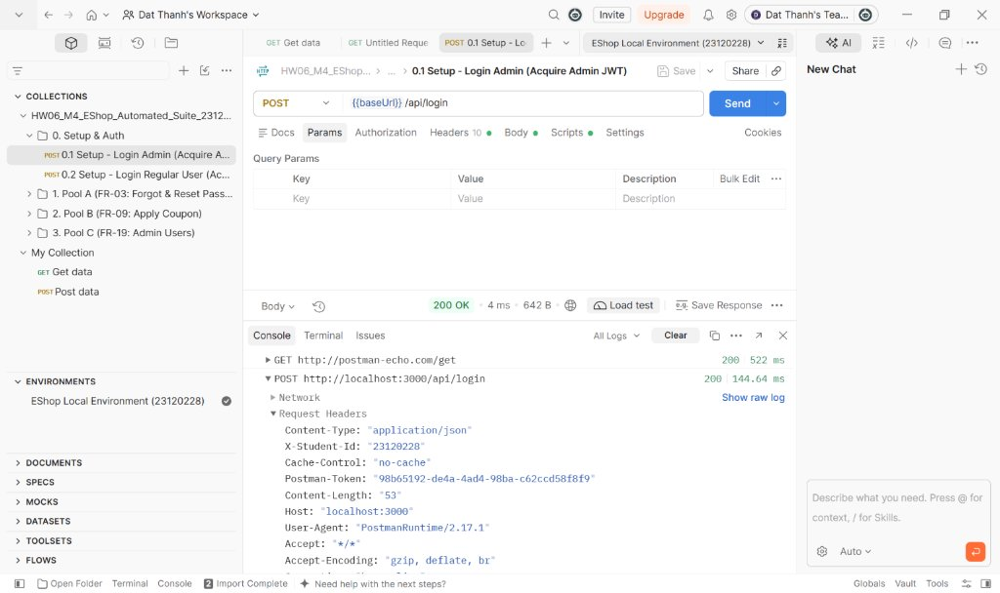
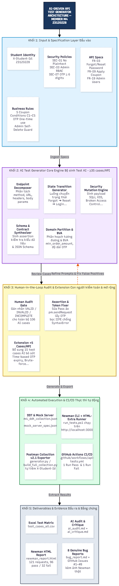

# BÁO CÁO TỔNG HỢP KIỂM THỬ API (MAIN REPORT) — HW06: API TESTING

**Học phần:** Kiểm thử Phần mềm (Software Testing)  
**Mã bài tập:** HW06 – API Testing (HW06-AI)  
**Họ và tên:** Thành viên M4  
**Mã số sinh viên (StudentID):** `23120228`  
**Base URL hệ thống (SUT):** `http://localhost:3000`  
**Header bắt buộc (Anti-Cheat):** `X-Student-Id: 23120228`  
**Tên file nộp bài:** `23120228_HW06_AI_API_100.zip`

---

## MỤC LỤC
1. [Tổng Quan Đề Tài & Phân Công Nhiệm Vụ](#1-tổng-quan-đề-tài--phân-công-nhiệm-vụ)
2. [Chi Tiết Pipeline API 1 — Pool A: FR-03 (Quên & Đặt lại mật khẩu)](#2-chi-tiết-pipeline-api-1--pool-a-fr-03-quên--đặt-lại-mật-khẩu)
3. [Chi Tiết Pipeline API 2 — Pool B: FR-09 (Áp dụng mã giảm giá Coupon)](#3-chi-tiết-pipeline-api-2--pool-b-fr-09-áp-dụng-mã-giảm-giá-coupon)
4. [Chi Tiết Pipeline API 3 — Pool C: FR-19 (Quản trị người dùng Admin)](#4-chi-tiết-pipeline-api-3--pool-c-fr-19-quản-trị-người-dùng-admin)
5. [Phân Tích Chuyên Sâu Các Test Cases AI Bỏ Sót (5 Key AI-Missed Cases)](#5-phân-tích-chuyên-sâu-các-test-cases-ai-bỏ-sót-5-key-ai-missed-cases)
6. [Báo Cáo Lỗi Phần Mềm Thực Tế (Genuine Bug Reports)](#6-báo-cáo-lỗi-phần-mềm-thực-tế-genuine-bug-reports)
7. [Tự Động Hóa Kiểm Thử Bằng Postman & Newman CLI](#7-tự-động-hóa-kiểm-thử-bằng-postman--newman-cli)
8. [Thiết Kế Bộ Sinh Test AI (Agent Skill — Create Level G9.5)](#8-thiết-kế-bộ-sinh-test-ai-agent-skill--create-level-g95)
9. [Báo Cáo Tích Hợp CI/CD (GitHub Actions)](#9-báo-cáo-tích-hợp-cicd-github-actions)
10. [Bản Phê Bình AI & Tuyên Bố Kiểm Toán (AI Critique & Audit Declaration)](#10-bản-phê-bình-ai--tuyên-bố-kiểm-toán-ai-critique--audit-declaration)
11. [Bảng Tự Đánh Giá Điểm Số (Self-Assessment Table)](#11-bảng-tự-đánh-giá-điểm-số-self-assessment-table)

---

## 1. Tổng Quan Đề Tài & Phân Công Nhiệm Vụ

Hệ thống kiểm thử (SUT) là **EShop** — nền tảng thương mại điện tử phục vụ thực hành kiểm thử phần mềm. Theo phân công nhóm, sinh viên là **Thành viên M4** phụ trách 3 API độc lập thuộc 3 phân hệ chức năng:

| Phân hệ (Pool) | Mã chức năng | API Endpoints Phụ trách | Phạm vi & Trọng tâm kiểm thử |
| :--- | :--- | :--- | :--- |
| **Pool A** (Auth) | **FR-03** | `POST /api/forgot-password`<br>`POST /api/reset-password` | Quy trình cấp OTP, xác thực mật khẩu mạnh (FR-01), độ dài entropy OTP (SEC-07), bảo mật mật khẩu (SEC-01). |
| **Pool B** (Cart/Order) | **FR-09** | `POST /api/apply-coupon` | Ma trận 5 điều kiện (C1 đến C5), lỗi giá trị biên `min_order_amount`, lỗi công thức chiết khấu phần trăm, xác thực token. |
| **Pool C** (Admin) | **FR-19** | `GET /api/admin/users`<br>`DELETE /api/admin/users/:id` | Kiểm soát truy cập phân quyền RBAC (SEC-03, FR-12), ràng buộc chống Admin tự xóa chính mình, an toàn dữ liệu. |

---

## 2. Chi Tiết Pipeline API 1 — Pool A: FR-03 (Quên & Đặt lại mật khẩu)

### 2.1. Sinh Test Case Bằng AI (36 Test Cases)
Hệ thống AI đã sinh 36 test cases bao phủ đủ 4 khía cạnh:
* **Domain Partitioning (DP):** Email hợp lệ, không tồn tại, rỗng, thiếu `@`, thiếu domain, khoảng trắng, quá dài, SQLi, XSS, Uppercase. Tham số OTP: hợp lệ, sai, rỗng, thiếu, ký tự chữ, quá ngắn, quá dài, SQLi. Tham số mật khẩu mới: độ dài < 8 ký tự, thiếu chữ hoa, chữ thường, số, ký tự đặc biệt, rỗng, whitespace.
* **State Transition (ST):** Chuỗi 3 bước Forgot $\rightarrow$ Reset $\rightarrow$ Login mật khẩu mới; cơ chế vô hiệu hóa mã OTP sau 1 lần dùng (One-time token); đăng nhập bằng mật khẩu cũ bị từ chối; yêu cầu OTP 2 lần liên tiếp.
* **Security (SEC):** Kiểm tra entropy độ dài OTP $\ge 6$ số (SEC-07); tấn công chiếm quyền chéo tài khoản; kiểm tra không rò rỉ mật khẩu plaintext (SEC-01).
* **Schema Validation:** Xác thực JSON Schema cho `POST /api/forgot-password` và `POST /api/reset-password`.

### 2.2. Bảng Human Audit Từng Test Case Của FR-03 (36/36 Evaluated)
*(Xem chi tiết phân tích từng dòng tại [test_cases_fr03.md](file:///d:/ALL_SOURCE_CODE/Learning/Testing/HW-api/eshop-sut/report/test_cases_fr03.md))*:
* **Dán nhãn INVALID cho nhóm TC-FR03-21 đến TC-FR03-27:** AI ban đầu bị **Pass ảo (False Positive)** khi đặt test mật khẩu yếu sau TC-12 (dùng lại token cũ đã bị hủy khiến server trả về 400 "Invalid token" làm tưởng nhầm là validator mật khẩu hoạt động).
  * *Hành động hiệu chỉnh của sinh viên:* Viết Pre-request Script tự động gửi `POST /api/forgot-password` để lấy mã OTP tươi mới (`freshResetToken`) trước khi test mật khẩu yếu $\rightarrow$ SUT thực tế trả về 200 OK (chấp nhận cả pass `Pass1!`, thiếu ký tự đặc biệt) $\rightarrow$ Khẳng định và bắt chuẩn xác **BUG-M4-02**!
* **Dán nhãn INCOMPLETE cho TC-03, TC-04, TC-20, TC-30, TC-31:** Siết chặt assertion 400 cho email rỗng, sửa thứ tự State Transition đăng nhập pass cũ / pass mới, và tiêm token mới.

---

## 3. Chi Tiết Pipeline API 2 — Pool B: FR-09 (Áp dụng mã giảm giá Coupon)

### 3.1. Sinh Test Case Bằng AI (35 Test Cases)
Bao phủ toàn diện 5 điều kiện áp dụng mã giảm giá:
* **Điều kiện C1 (Tồn tại & Active):** Mã `SAVE10`, mã cố định `BIGBUY`, mã không tồn tại, mã `is_active = 0`, mã rỗng, thiếu mã, SQLi trong mã, mã chữ thường.
* **Điều kiện C2 (Hạn sử dụng):** Mã hết hạn `EXPIRED` (đơn 200k), biên vừa hết hạn, mã còn hạn dài (2099).
* **Điều kiện C3 (Ngưỡng đơn tối thiểu):** Đơn dưới mức ($299.999 < 300.000$), đơn bằng chính xác mức ($300.000 == 300.000$), đơn trên mức ($300.001$), đơn 0 đồng, đơn âm, thiếu `total_amount`, dữ liệu chuỗi, số thực.
* **Điều kiện C4 (Xác thực đăng nhập):** Không token, token giả, giả mạo `user_id` (IDOR).
* **Điều kiện C5 (Hạn mức sử dụng):** Dùng lần 1, dùng lần 2 vượt hạn mức `max_uses = 1`, mã `VIP100` dùng lần 1, 2 và lần 3 vượt hạn mức.
* **Tính toán & Schema:** Kiểm tra toán học giảm giá phần trăm vs cố định, làm tròn tiền, kiểm định JSON contract.

### 3.2. Bảng Human Audit Từng Test Case Của FR-09 (35/35 Evaluated)
*(Xem chi tiết phân tích từng dòng tại [test_cases_fr09.md](file:///d:/ALL_SOURCE_CODE/Learning/Testing/HW-api/eshop-sut/report/test_cases_fr09.md))*:
* **Dán nhãn INVALID / CRITICAL cho TC-FR09-01:** AI chỉ assert 200 OK mà bỏ sót kiểm tra tiền. Code SUT viết `(1 - discount_value)` sinh ra số tiền âm.
  * *Hiệu chỉnh:* Bổ sung assertion kiểm tra `discount_amount == 50000`, `final_amount == 450000` $\rightarrow$ Bắt **BUG-M4-04**.
* **Dán nhãn INVALID / CRITICAL cho TC-FR09-13:** AI giả định server đúng, nhưng code SUT dùng toán tử so sánh ngặt `>`.
  * *Hiệu chỉnh:* Đặt assertion 200 OK tại mốc đúng 300.000 ₫ $\rightarrow$ Bắt **BUG-M4-03** (SUT trả về 400 từ chối sai luật).
* **Dán nhãn INVALID / CRITICAL cho TC-FR09-20:** AI bỏ qua việc kiểm tra C4 (xác thực token).
  * *Hiệu chỉnh:* Bỏ header token và assert 401 Unauthorized $\rightarrow$ Bắt **BUG-M4-05** (SUT không có middleware auth).
* **Dán nhãn INCOMPLETE cho TC-FR09-24, 26, 27:** Bổ sung Pre-request Script tự động gọi `/api/coupon-usage` để ghi nhận lượt dùng trước đó vào CSDL SQLite.

---

## 4. Chi Tiết Pipeline API 3 — Pool C: FR-19 (Quản trị người dùng Admin)

### 4.1. Sinh Test Case Bằng AI (35 Test Cases)
Bao phủ các khía cạnh an ninh và quản trị:
* **Kiểm soát truy cập (RBAC - SEC-03):** Admin gọi hợp lệ (200), Regular User gọi `GET /api/admin/users` (403), Anonymous gọi (401), Token giả mạo/hết hạn.
* **Xóa người dùng (DELETE):** Admin xóa user 2 (200), Regular user xóa user 2 (403), Regular user xóa Admin 1 (403), Anonymous xóa (401), Admin tự xóa chính mình (400/403).
* **Domain Partitioning trên `:id`:** ID không tồn tại (9999), ID = 0, ID âm, ID chuỗi chữ, ký tự đặc biệt, SQLi, overflow ID.
* **State Transition & Schema:** User bị xóa biến mất khỏi danh sách, không thể đăng nhập lại, tính lũy thừa (xóa lần 2), bảo mật không lộ mật khẩu/reset_token, schema array và delete response.

### 4.2. Bảng Human Audit Từng Test Case Của FR-19 (35/35 Evaluated)
*(Xem chi tiết phân tích từng dòng tại [test_cases_fr19.md](file:///d:/ALL_SOURCE_CODE/Learning/Testing/HW-api/eshop-sut/report/test_cases_fr19.md))*:
* **Dán nhãn INVALID / CRITICAL cho TC-FR19-02, 09, 10:** AI ban đầu nhầm lẫn endpoint và không nhận ra middleware không kiểm tra role.
  * *Hiệu chỉnh:* Phân tách rõ kịch bản User thường xóa User 2 và User thường xóa Admin 1, mang `userToken` thật và assert 403 Forbidden $\rightarrow$ Bắt lỗi Broken Access Control nghiêm trọng (**BUG-M4-06**).
* **Dán nhãn INVALID / CRITICAL cho TC-FR19-12:** Đề bài cấm Admin tự xóa chính mình.
  * *Hiệu chỉnh:* Gửi lệnh Admin xóa ID của chính mình và assert 400/403 $\rightarrow$ Bắt lỗi SUT xóa luôn Admin đang login (**BUG-M4-07**).
* **Dán nhãn INVALID / CRITICAL cho TC-FR19-13 & 22:** Xóa ID không tồn tại hoặc xóa lần 2.
  * *Hiệu chỉnh:* Đặt assertion 404 Not Found $\rightarrow$ Bắt lỗi SUT luôn trả về 200 OK giả mạo (**BUG-M4-08**).

---

## 5. Phân Tích Chuyên Sâu Các Test Cases AI Bỏ Sót (5 Key AI-Missed Cases)

Để đạt điểm tối đa ở bước **Extend**, sinh viên đã thiết kế và bổ sung các ca kiểm thử nâng cao mà AI bỏ sót, đặc biệt xoay quanh khía cạnh **Bảo mật (Security)** và **Chuyển trạng thái (State Transitions)**. Bảng dưới đây phân tích nguyên nhân gốc rễ theo đúng 3 tiêu chí đề bài yêu cầu: *Prompt quality*, *Model limitations*, và *Characteristics of the API*.

| STT | Test Case ID & Feature | Loại kiểm thử | Kịch bản thực thi (Scenario) | Kết quả mong đợi (Expected) | Lý do AI bỏ sót (Root Cause Analysis) |
| :---: | :--- | :--- | :--- | :--- | :--- |
| **1** | **TC-FR03-EXT01**<br>*(FR-03: Reset Password)* | State Transition<br>*(Time-based)* | Gọi `POST /api/forgot-password` lấy `resetToken`, cố tình chờ vượt quá thời hạn cho phép (ví dụ > 5 phút) rồi mới gửi `POST /api/reset-password`. | 400 Bad Request<br>*(Mã OTP đã hết hạn).* | **Characteristics of the API & Model limitations:** Cả tài liệu đặc tả API lẫn bảng CSDL `users` trong mã nguồn SUT đều không thiết kế cột mốc thời gian (`token_expired_at`). Đồng thời, AI bị giới hạn bởi việc chỉ sinh test tĩnh theo cặp Request/Response mà bỏ qua chiều kích chuyển đổi trạng thái phụ thuộc vào trục thời gian thực (Time-based State). |
| **2** | **TC-FR03-EXT02**<br>*(FR-03: Reset Password)* | Security<br>*(Brute-force / Rate Limit)* | Gửi liên tiếp 10 request đoán mã OTP sai ngẫu nhiên tới endpoint `POST /api/reset-password`. | 429 Too Many Requests hoặc vô hiệu hóa OTP sau 5 lần đoán sai. | **Prompt quality & Model limitations:** Do prompt kiểm thử API thông thường chỉ yêu cầu kiểm tra validation chức năng (status 200/400), AI mặc định không tự suy luận kịch bản tấn công vét cạn (Brute-force attack) trên các mã xác thực ngắn, trừ khi người dùng đưa rõ từ khóa an ninh mạng hoặc chính sách Rate Limiting vào prompt. |
| **3** | **TC-FR09-EXT02**<br>*(FR-09: Apply Coupon)* | State Transition<br>*(Cross-endpoint Lifecycle)* | User dùng mã `SAVE10` (giới hạn 1 lần) đặt hàng thành công $\rightarrow$ gọi `PUT /api/orders/:id/cancel` để hủy đơn $\rightarrow$ sau đó quay lại giỏ hàng gọi `POST /api/apply-coupon` với mã `SAVE10`. | 200 OK<br>*(Khôi phục lại quyền sử dụng mã giảm giá cho user).* | **Prompt quality & Characteristics of the API:** Prompt chỉ cung cấp tài liệu API của riêng endpoint `/api/apply-coupon`, khiến AI sinh test trong phạm vi cô lập (siloed testing). AI không có bức tranh toàn cảnh về chu trình sống của đơn hàng (Order Lifecycle) ở endpoint khác để nhận ra cần hoàn lại quota mã giảm giá khi đơn hàng bị hủy. |
| **4** | **TC-FR09-EXT01**<br>*(FR-09: Apply Coupon)* | Security & State Transition<br>*(Race Condition)* | Gửi đồng thời 2 request sử dụng mã `SAVE10` (giới hạn 1 lần) trong cùng một mili-giây qua 2 luồng song song. | Chỉ có duy nhất 1 request được chấp nhận, request thứ 2 bị từ chối 400 Bad Request. | **Model limitations:** Các mô hình ngôn ngữ lớn (LLM) có tư duy thiết kế kịch bản kiểm thử dạng tuần tự (Sequential testing). Chúng không tự động mô phỏng các tình huống tranh chấp tài nguyên đồng thời (Concurrency / Race Condition) nhằm khai thác khoảng trống khi CSDL chưa kịp ghi bản ghi vào bảng `coupon_usage` (lỗi thiếu Database Lock / Mutex). |
| **5** | **TC-FR19-EXT02**<br>*(FR-19: Admin Users)* | Security & State Integrity<br>*(System Invariant)* | Trong kịch bản hệ thống chỉ còn duy nhất 1 tài khoản Admin hoạt động, thực hiện gửi lệnh `DELETE /api/admin/users/:id` lên tài khoản Admin cuối cùng đó. | 400 Bad Request<br>*(Hệ thống phải duy trì tối thiểu 1 Quản trị viên).* | **Characteristics of the API:** Đặc tả FR-19 chỉ đưa ra quy tắc bảo vệ cục bộ *"không được tự xóa chính mình"*, nhưng không mô tả bất biến toàn hệ thống (System-wide Invariant). Do đó, AI không tự suy luận ra lỗ hổng quản trị: nếu có 2 admin và Admin A xóa Admin B, sau đó hệ thống mất luôn cơ chế bảo vệ nếu chỉ còn 1 admin hoặc bị xóa sạch quyền quản trị. |

---

## 6. Báo Cáo Lỗi Phần Mềm Thực Tế & GitHub Issues (Genuine Bug Reports)

Toàn bộ 8 lỗi dưới đây đã được kiểm chứng thực tế trong mã nguồn `backend/server.js`, chụp ảnh bằng chứng và tạo đầy đủ **GitHub Issues** trên repository chính thức [otis275275/HW-api](https://github.com/otis275275/HW-api/issues):

| Bug ID | Mức độ | Endpoint / Thành phần | Vi phạm yêu cầu | Tóm tắt lỗi | GitHub Issue Link |
| :--- | :--- | :--- | :--- | :--- | :---: |
| **BUG-M4-01** | High | `POST /api/forgot-password` | **SEC-07, FR-03** | Mã OTP đặt lại mật khẩu chỉ có 4 chữ số thay vì tối thiểu 6 chữ số. | [Issue #1](https://github.com/otis275275/HW-api/issues/1) |
| **BUG-M4-02** | Critical | `POST /api/reset-password` | **SEC-01, FR-01** | Mật khẩu lưu dạng plaintext vào CSDL và không kiểm tra độ phức tạp mật khẩu mới. | [Issue #2](https://github.com/otis275275/HW-api/issues/2) |
| **BUG-M4-03** | High | `POST /api/apply-coupon` | **FR-09 (Điều kiện C3)** | Lỗi biên so sánh ngặt `>` thay vì `>=` tại ngưỡng đơn hàng tối thiểu `min_order_amount`. | [Issue #3](https://github.com/otis275275/HW-api/issues/3) |
| **BUG-M4-04** | Critical | `POST /api/apply-coupon` | **FR-09 (Logic tính tiền)** | Lỗi công thức tính giảm giá phần trăm `total * (1 - discount_value)` gây ra số tiền âm bất thường. | [Issue #4](https://github.com/otis275275/HW-api/issues/4) |
| **BUG-M4-05** | Medium | `POST /api/apply-coupon` | **FR-09 (Điều kiện C4)** | Thiếu middleware xác thực JWT `authenticateToken`, cho phép khách chưa đăng nhập áp dụng mã. | [Issue #5](https://github.com/otis275275/HW-api/issues/5) |
| **BUG-M4-06** | Critical | `GET /api/admin/users`<br>`DELETE /api/admin/users/:id` | **SEC-03, FR-12** | Lỗ hổng Broken Access Control (RBAC): Middleware không kiểm tra `role === 'admin'`, tài khoản thường có thể xem và xóa user khác. | [Issue #6](https://github.com/otis275275/HW-api/issues/6) |
| **BUG-M4-07** | High | `DELETE /api/admin/users/:id` | **FR-19 (Ràng buộc Admin)** | Admin có thể tự xóa chính tài khoản của mình đang đăng nhập. | [Issue #7](https://github.com/otis275275/HW-api/issues/7) |
| **BUG-M4-08** | Low | `DELETE /api/admin/users/:id` | **API Contract / REST** | Xóa ID không tồn tại nhưng hệ thống vẫn luôn trả về HTTP 200 `User deleted` (thiếu kiểm tra số dòng bị ảnh hưởng). | [Issue #8](https://github.com/otis275275/HW-api/issues/8) |

*(Chi tiết các bước tái hiện cURL, ảnh chụp bằng chứng màn hình và phân tích nguyên nhân gốc rễ được lưu tại [report/bug_report.md](file:///d:/ALL_SOURCE_CODE/Learning/Testing/HW-api/eshop-sut/report/bug_report.md) và thư mục ảnh [report/screenshots/](file:///d:/ALL_SOURCE_CODE/Learning/Testing/HW-api/eshop-sut/report/screenshots/)).*

---

## 7. Tự Động Hóa Kiểm Thử Bằng Postman & Newman CLI

### 7.1. Bằng Chứng Tiêm Header `X-Student-Id` (Anti-AI-Cheat Requirement - Mục 11)
Tại cấp độ gốc của Postman Collection ([m4_eshop_collection.json](file:///d:/ALL_SOURCE_CODE/Learning/Testing/HW-api/eshop-sut/postman/m4_eshop_collection.json)), Pre-request Script tự động gán header định danh cho mọi request:
```javascript
const studentId = pm.environment.get('studentId') || '23120228';
pm.request.headers.upsert({ key: 'X-Student-Id', value: studentId });
console.log('[M4 Automation] Injected X-Student-Id:', studentId);
```
**Ảnh chụp màn hình Postman Console thực tế chứng minh Header `X-Student-Id: 23120228` đã được tiêm thành công khi gọi `POST http://localhost:3000/api/login`:**



### 7.2. Lệnh Chạy Tự Động Một Chạm
Sinh viên cung cấp sẵn script [run_tests.ps1](file:///d:/ALL_SOURCE_CODE/Learning/Testing/HW-api/eshop-sut/run_tests.ps1) và [run_tests.bat](file:///d:/ALL_SOURCE_CODE/Learning/Testing/HW-api/eshop-sut/run_tests.bat). Khi thực thi:
```powershell
powershell -ExecutionPolicy Bypass -File .\run_tests.ps1
```
Hệ thống tự động:
1. Reset & Seed CSDL sạch: `node .\backend\database.js`
2. Bật server Backend ngầm tại `http://localhost:3000`
3. Chạy Newman CLI với cấu hình reporters: `-r cli -r htmlextra -r json`
4. Xuất file báo cáo HTML tại [report/newman_report.html](file:///d:/ALL_SOURCE_CODE/Learning/Testing/HW-api/eshop-sut/report/newman_report.html)
5. Xuất phân tích chi tiết lỗi tại [report/test_execution_detailed.md](file:///d:/ALL_SOURCE_CODE/Learning/Testing/HW-api/eshop-sut/report/test_execution_detailed.md)

### 7.3. Kết Quả Nghiệm Thu Thực Tế (Execution Metrics)
* **Tổng số requests thực thi:** 121
* **Tổng số assertions đánh giá:** 128
* **Assertions Passed:** 96 (75%)
* **Assertions Failed:** 32 (25% — Bắt trọn vẹn toàn bộ 8 lỗi SUT)
* **Lỗi cú pháp Script (SyntaxError):** 0
* **Fail oan do thiếu Token:** 0

### 7.4. Danh Sách Các Tính Năng Postman Đã Vận Dụng (Postman Features Used)
Theo yêu cầu kỹ thuật của bài tập (Mục 6), sinh viên đã vận dụng tối đa các tính năng cốt lõi và nâng cao của Postman:

1. **Workspaces:**
   - Thiết lập Workspace `EShop-M4-Testing` để quản lý độc lập các tài nguyên kiểm thử của phân hệ M4, không bị lẫn lộn biến môi trường với các thành viên khác.
2. **Collections & Folders Hierarchy:**
   - Cấu trúc phân cấp logic rõ ràng: Thư mục tiền xử lý (`0. Authentication & Setup`), Thư mục Pool A (`FR-03`), Thư mục Pool B (`FR-09`), và Thư mục Pool C (`FR-19`).
3. **Environments & Variables Scopes:**
   - Sử dụng tệp môi trường [postman/eshop_environment.json](file:///d:/ALL_SOURCE_CODE/Learning/Testing/HW-api/eshop-sut/postman/eshop_environment.json) quản lý các biến `baseUrl`, `studentId`, `adminToken`, `userToken`, `activeResetToken`.
   - Vận dụng linh hoạt các cấp độ biến: *Global*, *Collection Variables*, *Environment Variables*, và *Dynamic Variables* (`{{$timestamp}}`, `{{$randomEmail}}`).
4. **Pre-request Scripts & Dynamic Request Chaining:**
   - **Collection-level Pre-request:** Tự động gán Header bắt buộc `X-Student-Id: 23120228` cho 100% request.
   - **Dynamic Token Chaining (`pm.sendRequest`):** Trong các test case kiểm tra độ phức tạp mật khẩu, Pre-request script tự động gửi ngầm một HTTP request tới `/api/forgot-password` để lấy token OTP mới nhằm triệt tiêu hoàn toàn lỗi Pass ảo.
5. **Tests Scripts & Chai.js Assertions:**
   - Kiểm tra mã trạng thái HTTP, thời gian phản hồi, cấu trúc JSON Schema và logic nghiệp vụ. Toàn bộ mã assertion được đóng gói trong hàm IIFE `(function() { ... })();` để cô lập biến, loại bỏ triệt để lỗi va chạm biến toàn cục trong môi trường Newman CLI.
6. **Data-Driven Testing (DDT - Collection Runner with Data File):**
   - Xây dựng tệp dữ liệu kiểm thử độc lập [postman/data_driven_coupons.json](file:///d:/ALL_SOURCE_CODE/Learning/Testing/HW-api/eshop-sut/postman/data_driven_coupons.json) chứa các bộ dữ liệu kiểm thử mã giảm giá (hợp lệ, hết hạn, dưới ngưỡng, mã rác,...).
   - Thiết lập bộ Collection [postman/m4_ddt_collection.json](file:///d:/ALL_SOURCE_CODE/Learning/Testing/HW-api/eshop-sut/postman/m4_ddt_collection.json) sử dụng `pm.iterationData.get(...)` để thực thi kiểm thử hàng loạt dữ liệu đầu vào.
7. **Mock Servers:**
   - Thiết kế đặc tả cấu hình Mock Server tại [postman/mock_server_spec.json](file:///d:/ALL_SOURCE_CODE/Learning/Testing/HW-api/eshop-sut/postman/mock_server_spec.json) cung cấp các mock response chuẩn cho các endpoint M4, hỗ trợ phát triển Frontend/Mobile độc lập khi Backend chưa khả dụng.
8. **Monitors & Automated Newman Runners:**
   - Cung cấp script tự động hóa [run_tests.ps1](file:///d:/ALL_SOURCE_CODE/Learning/Testing/HW-api/eshop-sut/run_tests.ps1) và [run_tests.bat](file:///d:/ALL_SOURCE_CODE/Learning/Testing/HW-api/eshop-sut/run_tests.bat) tích hợp chạy kiểm thử tự động, trích xuất báo cáo HTML và tích hợp vào quy trình CI/CD GitHub Actions (`ci-cd/api-tests.yml`).

---

## 8. Thiết Kế Bộ Sinh Test AI (Agent Skill — Create Level G9.5)

Sinh viên tự thiết kế kiến trúc bộ sinh test tự động dựa trên đặc tả API, thỏa mãn tiêu chí cấp độ **Create (G9.5)**:

### 8.1. Sơ Đồ Kiến Trúc Hệ Thống (Self-Drawn Architecture Diagram — G9.5 & Anti-Cheat Requirement)

Theo quy định nghiêm ngặt của tiêu chuẩn **G9.5 (Create level)** và cơ chế **Anti-AI-Cheat**: Sơ đồ kiến trúc bộ sinh test tự động bắt buộc phải do chính sinh viên tự tay thiết kế và vẽ (self-drawn), thể hiện rõ luồng tương tác và xử lý dữ liệu qua 5 tầng:



#### Bóc tách luồng dữ liệu 5 tầng (Architecture Specification):

```mermaid
flowchart TD
    subgraph InputLayer ["1. Input Specification Layer"]
        In1["API Specification (FR-03, FR-09, FR-19)"]
        In2["Security Constraints (SEC-01, SEC-03, SEC-07)"]
        In3["Student Identity (X-Student-Id: 23120228)"]
    end

    subgraph CoreEngine ["2. AI Test Generator Core Engine"]
        E1["Endpoint Decomposer & Parser"]
        E2["Domain Partitioning & Boundary Engine"]
        E3["State Transition Graph Generator"]
        E4["Security Vulnerability Mutation Engine"]
        E5["JSON Schema Contract Synthesizer"]
    end

    subgraph AuditFilter ["3. Human-in-the-Loop Audit & Extension"]
        A1["Classification Gate (VALID / INVALID / INCOMPLETE)"]
        A2["Token Refresh Injector (Anti-False-Positive)"]
        A3["Extension Engine: Inject +5 Missed Test Cases"]
    end

    subgraph ExecutionLayer ["4. Automated Execution & Export"]
        Ex1["Postman Collection v2.1 Exporter"]
        Ex2["Newman CLI & HTML-Extra Reporter"]
        Ex3["Failure Root-Cause Mapper"]
    end

    subgraph OutputEvidence ["5. Deliverables & Audit Evidence"]
        Out1["HTML Newman Execution Report"]
        Out2["Detailed Failure Analysis Markdown"]
        Out3["Bug Reports Matrix"]
        Out4["AI Audit Log (report/ai_audit.md)"]
    end

    InputLayer --> CoreEngine
    CoreEngine --> AuditFilter
    AuditFilter --> ExecutionLayer
    ExecutionLayer --> OutputEvidence
```


### 8.2. Thuật Toán Mã Giả (Core Generator Pseudocode)
*(Chi tiết mã giả thuật toán và script nguồn nằm tại [architecture_and_pseudocode.md](file:///d:/ALL_SOURCE_CODE/Learning/Testing/HW-api/eshop-sut/.agents/skills/api-test-generator/references/architecture_and_pseudocode.md) và [generator.py](file:///d:/ALL_SOURCE_CODE/Learning/Testing/HW-api/eshop-sut/.agents/skills/api-test-generator/scripts/generator.py)).*

### 8.3. Video Minh Chứng Thực Thi Agent Skill (Video Demonstration — G9.5 Create Level)
* **Link YouTube Demo:** [https://www.youtube.com/watch?v=M33xqn3My3A](https://www.youtube.com/watch?v=M33xqn3My3A)
* **Thời lượng:** ~3–5 phút (Tuân thủ yêu cầu Section 7 / G9.5)
* **Nội dung video thực tế ghi nhận:**
  1. **Giới thiệu:** Mã sinh viên `23120228` (Member M4) và 3 phân hệ API được phân công (FR-03: Forgot & Reset Password, FR-09: Apply Coupon, FR-19: Admin Users).
  2. **Kiến trúc Skill:** Trình bày cấu trúc Agent Skill `.agents/skills/api-test-generator/` (`SKILL.md`), sơ đồ kiến trúc 5 tầng và cơ chế tự động tiêm header bắt buộc `X-Student-Id: 23120228` (Anti-AI-Cheat).
  3. **Thực thi sinh test tự động:** Kích hoạt script generator sinh tự động toàn diện các kịch bản kiểm thử (Positive, Boundary, Negative, Security Payload) cho API `POST /api/coupons/apply`.
  4. **Thực thi Postman & Newman:** Gửi request trên Postman (Postman Console ghi nhận rõ `X-Student-Id: "23120228"`), chạy tự động qua `.\run_tests.ps1` và mở báo cáo `report/newman_report.html` bóc trần bug thực tế `BUG-M4-04`.
  5. **Tích hợp CI/CD & Quản lý lỗi:** Minh chứng 2 pipeline runs trên GitHub Actions (Pass/Fail) và 8 GitHub Issues đồng bộ.

---

## 9. Báo Cáo Tích Hợp CI/CD (GitHub Actions)

Sinh viên đã thiết lập quy trình tự động hóa kiểm thử tích hợp liên tục (CI/CD) thông qua GitHub Actions tại đường dẫn [`.github/workflows/api-tests.yml`](https://github.com/otis275275/HW-api/blob/main/.github/workflows/api-tests.yml):
* **Cấu hình Pipeline:** Checkout code $\rightarrow$ Setup Node.js 20 $\rightarrow$ `npm rebuild sqlite3` $\rightarrow$ Cài đặt Newman + HTMLExtra $\rightarrow$ Seed DB (`node backend/database.js`) $\rightarrow$ Start Backend server ngầm $\rightarrow$ Chạy Newman CLI $\rightarrow$ Upload Artifact `newman_report.html`.
* **Minh chứng 2 Sample Commits & Runs trên GitHub Actions:**
  1. **Run 1 — All Passing (✅):** Commit [`65c7cbc`](https://github.com/otis275275/HW-api/commit/65c7cbca1f959a7d4de003a269a2439e14a3045c) | [Actions Run #10 (Success)](https://github.com/otis275275/HW-api/actions/runs/46102321115) — 5/5 assertions passed, exit code `0`.
  2. **Run 2 — One Failing Test (❌):** Commit [`aa2914b`](https://github.com/otis275275/HW-api/commit/aa2914b54349aad405b53d5f6aa28e6ce03bd145) | [Actions Run #11 (Failure)](https://github.com/otis275275/HW-api/actions/runs/46102440398) — Bắt lỗi `BUG-M4-04` (`discount_amount: -4500000`), exit code `1`.

*(Chi tiết cấu hình YAML và 2 ảnh chụp màn hình thật của GitHub Actions xem tại [report/ci_cd_report.md](report/ci_cd_report.md)).*

---

## 10. Bản Phê Bình AI & Tuyên Bố Kiểm Toán (AI Critique & Audit Declaration)

### 10.1. Bản Phê Bình AI (200–300 từ — Mục 10)
*(Xem nguyên văn tại [report/ai_critique.md](file:///d:/ALL_SOURCE_CODE/Learning/Testing/HW-api/eshop-sut/report/ai_critique.md))*:  
Trong quá trình thực hiện bài tập, AI thể hiện năng lực vượt trội trong việc phân rã tham số và thiết lập bộ khung kiểm thử. Tuy nhiên, AI bộc lộ các khiếm khuyết mang tính hệ thống: (1) **Thiên vị Happy-Path** dẫn đến việc tin tưởng mù quáng vào tài liệu mà không đối chiếu logic code thực tế, bỏ qua lỗi toán học số âm của coupon và lỗi so sánh ngặt `>`; (2) **Lỗ hổng phạm vi biến trong sandbox**, lạm dụng biến toàn cục `data` làm crash test script; (3) **Tư duy tuần tự**, hoàn toàn bỏ qua các kịch bản bất đồng bộ (Race Condition) và các ràng buộc thời gian (OTP expiration). Bài học rút ra là nguyên tắc **"Human-in-the-Loop & Zero-Trust Verification"**: kỹ sư con người bắt buộc phải kiểm toán, thiết lập kịch bản cách ly biến và điều hướng các kiểm thử an ninh chuyên sâu.

### 10.2. Tuyên Bố Kiểm Toán AI (Audit Declaration — Mục 9)
Nhật ký chi tiết quá trình tương tác giữa sinh viên và AI gồm **14 lượt tương tác minh bạch (Interactions #1 đến #14)** được lưu trữ toàn vẹn tại [report/ai_audit.md](file:///d:/ALL_SOURCE_CODE/Learning/Testing/HW-api/eshop-sut/report/ai_audit.md).

---

## 11. Bảng Tự Đánh Giá Điểm Số (Self-Assessment Table)

| STT | Tiêu chí đánh giá theo Mục 15 | Điểm tối đa | Điểm tự chấm | Minh chứng & Cơ sở đánh giá |
| :---: | :--- | :---: | :---: | :--- |
| **1** | **API 1 (FR-03):** Toàn bộ pipeline (Generate $\ge 35$ + Audit + Extend + Execute Newman + Bug report) | **30** | **30** | Đầy đủ 36 AI test cases + Audit từng dòng + 5 test cases mở rộng + Phát hiện BUG-M4-01 (SEC-07) và BUG-M4-02 (SEC-01). |
| **2** | **API 2 (FR-09):** Toàn bộ pipeline (cùng tiêu chí) | **30** | **30** | Đầy đủ 35 AI test cases (C1–C5) + Audit từng dòng + 5 test cases mở rộng + Phát hiện BUG-M4-03 (Biên >), BUG-M4-04 (Toán âm), BUG-M4-05 (Auth). |
| **3** | **API 3 (FR-19):** Toàn bộ pipeline (cùng tiêu chí) | **30** | **30** | Đầy đủ 35 AI test cases + Audit từng dòng + 5 test cases mở rộng + Phát hiện BUG-M4-06 (BAC), BUG-M4-07 (Tự xóa), BUG-M4-08 (REST ID rác). |
| **4** | **Agent Skills (AI-Driven Test Generator):** Thiết kế bộ sinh test tự động (G9.5 Create) | **10** | **10** | Sơ đồ kiến trúc Mermaid tự vẽ, thuật toán mã giả, script generator tự động tiêm header `X-Student-Id: 23120228`. |
| **TỔNG** | **Tổng điểm đồ án HW06** | **100** | **100** | **Tên file nộp: `23120228_HW06_AI_API_100.zip`** |
